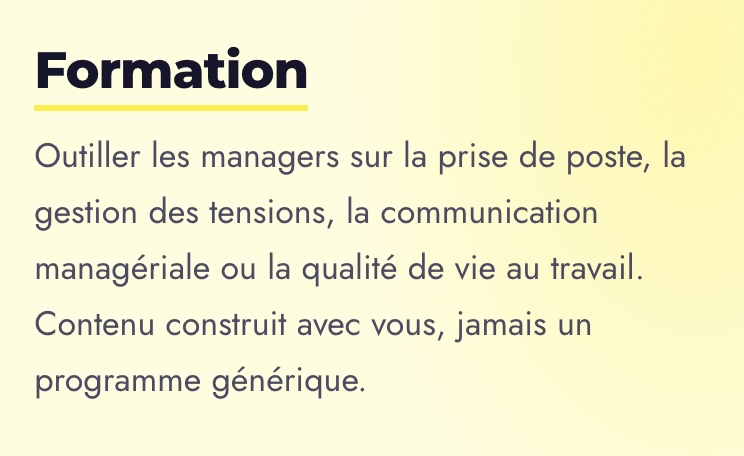

# Site Internet  
  
Logo   
  
Est-ce que tu peux mettre le bon stp ?  
Le voici :  
Le logo seul : pour le favicon :  
  
  
Le logo avec marqué W&J dessous  
  
  
Pour le formation :  
  
Peux-tu remplacer « ou la qualité de vie au travail » par « , l’organisation ou la cohésion intergénérationnelle »  
  
  
Certaines prestations sont …  
W&J est référencée dans la plupart des OPCO et vous aide à monter le dossier.  
  
Le sujet annoncé n’est pas toujours le sujet réel.  
  
Enseigne en BTS, Bachelor et Master depuis …  
  
